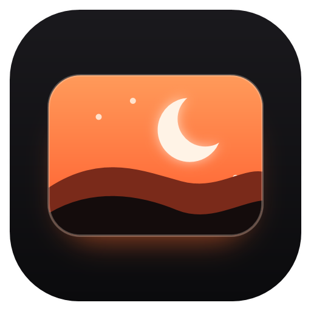
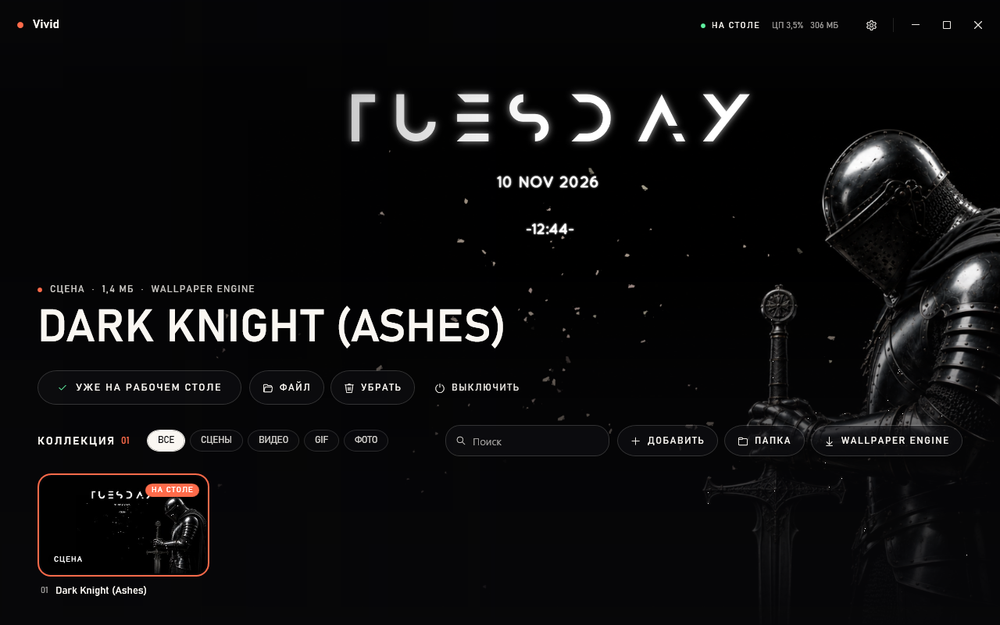
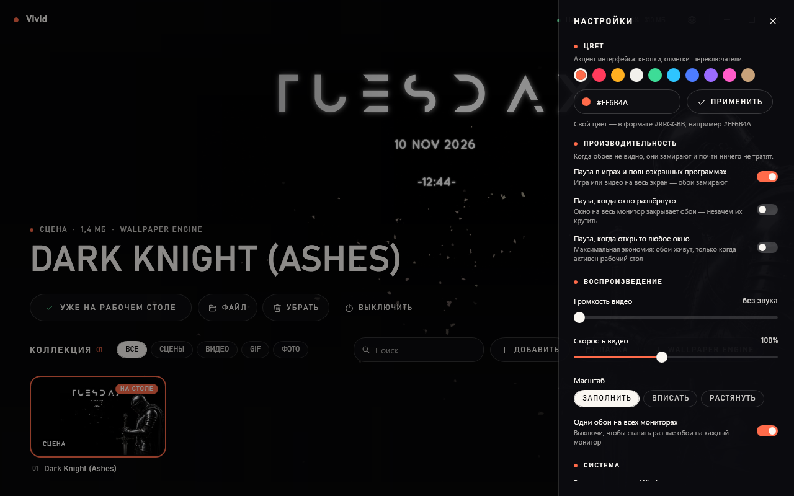

<p align="center">
  
</p>

<h1 align="center">Vivid — живые обои</h1>

<p align="center">
  Лёгкая программа живых обоев для Windows: видео, GIF, картинки и сцены Wallpaper Engine прямо на рабочем столе.<br>
  Почти не тратит процессор и сама замирает, когда обоев не видно.
</p>

<p align="center">
  
  
  
  
</p>



## Зачем это нужно

Привычные программы живых обоев бывают тяжёлыми: подтормаживают систему, держат видеокарту загруженной даже под игрой, а на новых сборках Windows 11 иногда показывают чёрный экран. Vivid делает то же самое проще:

- **один файл `.exe` на ~200 КБ**, ничего не нужно устанавливать, никаких сторонних библиотек;
- **около 0,5–1 % процессора** на живой сцене: картинку и анимации ведёт системный композитор Windows, а не программа;
- **авто-пауза**: игра или окно на весь экран — обои замирают и ничего не тратят;
- **работает на новом рабочем столе Windows 11 (24H2 и новее)**, где многие обычные окна за иконками просто не видны.

## Кому это нужно

1. **Тем, у кого тормозит или чернеет Wallpaper Engine**, — можно забрать свои обои и пользоваться лёгкой программой.
2. **Геймерам**: обои не отнимают ресурсы, пока ты в игре.
3. **Тем, кто любит красивый рабочий стол**: видео, GIF, картинки и сцены с частицами и живыми часами.
4. **Владельцам ноутбуков и слабых ПК**: минимум нагрузки и памяти.
5. **Разработчикам**: открытый код без внешних зависимостей и пример вывода на рабочий стол Windows 11 через Windows.UI.Composition.

## Возможности

| Что | Как |
|---|---|
| **Видео** | MP4, WEBM, MKV, MOV, AVI, WMV — аппаратное декодирование системным плеером Windows, бесшовный повтор |
| **GIF и картинки** | GIF, JPG, PNG, BMP, WEBP; масштаб: заполнить / вписать / растянуть |
| **Сцены Wallpaper Engine** | Открывает `scene.pkg`: слои-картинки, частицы (пепел, снег, искры), надписи со скриптами — живые часы и дата |
| **Импорт из Wallpaper Engine** | Кнопка находит папки Wallpaper Engine (Steam-мастерская и свои проекты) и добавляет обои в коллекцию |
| **Коллекция** | Живой предпросмотр выбранных обоев на всё окно, фильтры, поиск, перетаскивание файлов в окно |
| **Авто-пауза** | Пауза в играх и полноэкранных программах, при развёрнутом окне или при любом активном окне — на выбор |
| **Несколько мониторов** | Одни обои на всех или свои на каждом |
| **Цвет интерфейса** | 10 готовых цветов или свой `#RRGGBB` |
| **Автозапуск** | Стартует вместе с Windows тихо, в трей; окно при включении можно не показывать |
| **Трей** | Открыть, пауза, случайные обои, выключить живые обои, выход |



## Установка

Готовых сборок пока нет — программа собирается из исходников встроенным в Windows компилятором, ничего ставить не нужно.

1. Скачай репозиторий (**Code → Download ZIP**) и распакуй.
2. Запусти PowerShell в папке и выполни:

   ```powershell
   powershell -ExecutionPolicy Bypass -File build.ps1
   ```

3. Готовая программа — `bin\Vivid.exe`. Её можно положить куда удобно, например в `%LOCALAPPDATA%\Programs\Vivid`.

## Как пользоваться

- **Добавить обои** — кнопка «Добавить», «Папка» или просто перетащи файлы в окно. Файлы никуда не копируются: программа запоминает, где они лежат.
- **Поставить** — выбери обои в коллекции и нажми «Установить на рабочий стол» (или двойной щелчок по карточке).
- **Закрыть окно** — обои продолжают работать, программа уходит в трей. Полный выход — через меню значка в трее.
- **Из командной строки**: `Vivid.exe путь\к\видео.mp4` — добавить и сразу поставить; `Vivid.exe /tray` — запуск без окна; `Vivid.exe /quit` — закрыть запущенную копию.

Настройки и коллекция хранятся в `%APPDATA%\Vivid`.

## Как это устроено

- **Вывод на рабочий стол.** Окно обоев встраивается в слой рабочего стола под иконками, а содержимое рисует системный композитор (Windows.UI.Composition): видео — через `MediaPlayer`, картинки — прямо в видеопамять через Direct3D 11. Именно такой вывод виден на новом рабочем столе Windows 11.
- **Частицы.** Путь каждой частицы рассчитывается один раз при её появлении, дальше движение, вращение и прозрачность анимирует сам композитор — поэтому процессор почти не занят.
- **Сцены Wallpaper Engine.** Читается архив `scene.pkg` и текстуры `.tex` (PNG/JPG внутри, RGBA, R8, DXT1/3/5, сжатие LZ4). Скрипты надписей выполняются встроенным в Windows движком JavaScript (Chakra).
- **Интерфейс** — WPF, без XAML-файлов и сторонних пакетов.

## Ограничения

- Поддерживается часть возможностей сцен Wallpaper Engine: картинки, частицы и текст. 3D-модели, шейдерные эффекты и звук пока не воспроизводятся.
- Веб-обои (HTML) пока не поддерживаются.
- Для видео в WEBM может понадобиться расширение «VP9 Video Extensions» из Microsoft Store (обычно уже установлено).

## Лицензия

[MIT](LICENSE)
